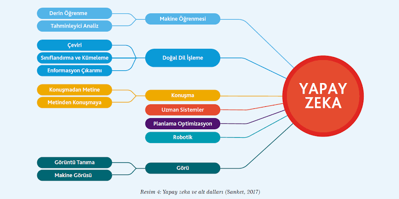

# YAPAY ZEKA (AI): DÜNDEN BUGÜNE, TEORİDEN PRATİĞE KAPSAMLI REHBER

## İÇİNDEKİLER

1. Giriş: Yapay Zeka Gerçekte Nedir?
2. Yapay Zekanın Tarihsel Gelişimi
   2.1. 1950'ler: Alan Turing ve Temeller
   2.2. 1960'lar - 1970'ler: İlk Beklentiler ve Kış Dönemi
   2.3. 1980'ler: Uzman Sistemlerin Yükselişi
   2.4. 1990'lar: İstatistiğin Geri Dönüşü
   2.5. 2010'lar ve Sonrası: Derin Öğrenme Devrimi
3. Zeka Kapasitesine Göre Sınıflandırma
   3.1. Dar (Zayıf) Yapay Zeka (ANI)
   3.2. Genel (Güçlü) Yapay Zeka (AGI)
   3.3. Süper Yapay Zeka (ASI)
4. Yapay Zekanın Temel Alt Dalları
   4.1. Makine Öğrenmesi (Machine Learning)
   4.2. Derin Öğrenme (Deep Learning)
   4.3. Doğal Dil İşleme (NLP)
   4.4. Bilgisayarlı Görü (Computer Vision)
   4.5. Robotik
5. Yazılım Mühendisliği, Web ve Mobil Dünyasında YZ
   5.1. Front-End Geliştirme (React & JavaScript) Etkisi
   5.2. Mobil Geliştirme (Flutter & Dart) Etkisi
6. Donanım ve Veri Altyapısı
   6.1. CPU ve GPU Mimarisi
   6.2. Veri Mühendisliğinin Rolü
7. Yapay Zekanın Artıları (Avantajlar)
8. Yapay Zekanın Zorlukları ve Etik Riskler
9. Geniş Kapsamlı Yapay Zeka Terimleri Sözlüğü
10. Sonuç ve Gelecek Vizyonu
11. Görsel Kavram Haritası
12. Kaynakça

---

## 1. GİRİŞ: YAPAY ZEKA GERÇEKTE NEDİR?

Günümüzde "Yapay Zeka" (YZ veya AI) dediğimizde aklımıza genellikle bilimkurgu filmlerindeki insanüstü robotlar gelse de, gerçek dünyadaki karşılığı çok daha sistematik ve matematiktir. 

Yapay zeka, en temel tanımıyla; insan zekasını taklit eden, çevresini algılayabilen, verilerden öğrenen ve belirli bir amaca ulaşmak için otonom veya yarı otonom kararlar verebilen bilgisayar sistemlerinin genel adıdır. 

Geleneksel bilgisayar programları, yazılımcının "eğer şu olursa bunu yap" (if-else) şeklinde yazdığı katı kurallara göre çalışır. Ancak yapay zeka sistemlerinde yaklaşım tamamen farklıdır. 
Bilgisayara kurallar verilmez; bilgisayara devasa boyutta veriler (fotoğraflar, metinler, sayılar) ve bu verilerin sonuçları verilir. Bilgisayar, aradaki kuralı matematiksel algoritmalar kullanarak kendisi bulur. 

Günümüzde cebimizdeki akıllı telefonlardan, internetteki arama motorlarına, hastanelerdeki MR cihazlarından, otonom araçlara kadar her şeyin kalbinde bu veri işleme gücü yatmaktadır.

---

## 2. YAPAY ZEKANIN TARİHSEL GELİŞİMİ

Yapay zeka bir gecede ortaya çıkan bir teknoloji değildir. Onlarca yıllık hayal kırıklıkları, kesilen fonlar ve ardından gelen büyük teknolojik sıçramaların birikimidir. Bu tarihsel süreci 5 ana döneme ayırabiliriz:

### 2.1. 1950'ler: Alan Turing ve İlk Kıvılcımlar
Tarihteki ilk somut adım, ünlü İngiliz matematikçi Alan Turing'in 1950 yılında yayımladığı "Hesaplama Makineleri ve Zeka" adlı makalesiyle atıldı. Turing, "Makineler düşünebilir mi?" sorusunu sorarak, bir makinenin insan zekasını taklit edip edemeyeceğini ölçen meşhur "Turing Testi"ni geliştirdi. 1956 yılında ise John McCarthy ve Marvin Minsky gibi bilim insanlarının düzenlediği **Dartmouth Konferansı'nda** "Yapay Zeka" (Artificial Intelligence) terimi tarihte ilk kez resmi olarak kullanıldı ve akademik bir bilim dalı olarak kabul edildi.

### 2.2. 1960'lar - 1970'ler: İlk İyimserlik ve "Birinci YZ Kışı"
Bu dönemde bilgisayarların satranç oynayabilmesi veya basit matematik teoremlerini çözmesi bilim dünyasında büyük bir heyecan yarattı. 1966'da tarihin ilk sohbet robotu olan **ELIZA** geliştirildi. Bilim insanları 10 yıl içinde insan zekasına ulaşacaklarını iddia ettiler. Ancak çok geçmeden acı gerçekle yüzleştiler: O dönemin bilgisayarları inanılmaz derecede yavaştı, hafızaları yetersizdi ve dünyayı anlamlandırmak için gereken "veri" ortada yoktu. Beklentiler karşılanamayıp projeler art arda çökünce hükümetler tüm maddi destekleri kesti. Tarihe **"Birinci Yapay Zeka Kışı"** olarak geçen bu dönemde araştırmalar neredeyse tamamen durdu.

### 2.3. 1980'ler: Uzman Sistemlerin Yükselişi ve Düşüşü
Yapay zeka, 1980'lerde insan zekasını kopyalamaya çalışmaktan vazgeçip, sadece belirli bir dar alanda uzmanlaşan kural tabanlı sistemlere yöneldi. Bunlara "Uzman Sistemler" dendi. Sisteme uzman bir doktorun veya mühendisin bildiği binlerce kural (Eğer X ise, Y yap) kodlandı. Şirketler bu sistemleri kullanarak milyonlarca dolar tasarruf edince yapay zeka yeniden popüler oldu. Ancak bu sistemler yeni durumlara uyum sağlayamayan, güncellenmesi çok zor ve hantal yapılardı. Bu hantallık, 80'lerin sonunda fonların tekrar kesilmesine ve **"İkinci Yapay Zeka Kışı"**nın yaşanmasına sebep oldu.

### 2.4. 1990'lar: İstatistiğin Geri Dönüşü ve Satranç Zaferi
90'lı yıllarda yazılım dünyası, katı kurallar yazmak yerine, makinelere büyük veriler verip istatistiksel olasılıkları hesaplatmaya (Makine Öğrenmesi) başladı. 1997 yılında IBM'in ürettiği **Deep Blue** adlı süper bilgisayar, dünya satranç şampiyonu Garry Kasparov'u yenerek tüm dünyanın dikkatini tekrar yapay zekaya çekti. Bu, kaba işlem gücünün ve istatistiğin insan zekasına karşı kazandığı ilk büyük zaferdi.

### 2.5. 2010'lar ve Sonrası: Derin Öğrenme Devrimi
2010'lu yıllara gelindiğinde üç sihirli teknoloji aynı anda zirveye ulaştı:
1. İnternetin yaygınlaşmasıyla milyarlarca fotoğraf ve metinden oluşan **Büyük Veri (Big Data)** havuzu oluştu.
2. Oyun oynamak için tasarlanan **Ekran Kartları (GPU)**, inanılmaz paralel işlem güçleriyle yapay zeka eğitiminde kullanılmaya başlandı.
3. İnsan beyninden ilham alan **Yapay Sinir Ağları (Derin Öğrenme)**, bu veri ve donanım gücüyle buluştu.
2012 yılındaki ImageNet görüntü tanıma yarışmasında derin öğrenme algoritmalarının gösterdiği olağanüstü başarı, bugünkü yapay zeka patlamasını başlattı. Bugün kullandığımız ChatGPT, Midjourney ve otonom araçlar tamamen bu devrimin ürünleridir.

---

## 3. ZEKA KAPASİTESİNE GÖRE SINIFLANDIRMA

Medyada yapay zeka genellikle tek bir kavram gibi kullanılsa da, zeka seviyelerine göre üç ana kategoriye ayrılır:

### 3.1. Dar (Zayıf) Yapay Zeka (ANI - Artificial Narrow Intelligence)
Sadece tek bir görevi yapabilmek üzere eğitilmiş yapay zekalardır. 
Şu an dünyada var olan tüm yapay zekalar bu sınıftadır. 
Örneğin, dünya Go şampiyonunu yenen AlphaGo, satrançta bir dahidir ancak ona "bana kahve yap" veya "bu resmi çevir" dediğinizde hiçbir şey yapamaz. 

### 3.2. Genel (Güçlü) Yapay Zeka (AGI - Artificial General Intelligence)
İnsan zekasına her alanda eşit olan teorik yapay zeka seviyesidir. 
Mantık yürütebilen, espri anlayabilen, öğrendiği bilgiyi tamamen farklı bir disipline transfer edebilen sistemlerdir. Henüz icat edilmemiştir, ancak araştırma laboratuvarlarının (OpenAI, DeepMind) nihai hedefidir.

### 3.3. Süper Yapay Zeka (ASI - Artificial Superintelligence)
İnsan zekasını sosyal, bilimsel ve sanatsal her alanda fersah fersah aşan teorik seviyedir. 
Bu aşamaya ulaşıldığında insanlığın gidişatı tamamen değişecektir (Singularity).

---

## 4. YAPAY ZEKANIN TEMEL ALT DALLARI

Yapay zeka devasa bir şemsiyedir. Bu şemsiyenin altında farklı problemleri çözen disiplinler vardır.

### 4.1. Makine Öğrenmesi (Machine Learning)
Makinelerin açıkça programlanmadan, verilerden örüntüler bularak öğrenmesidir.

* **Gözetimli Öğrenme:** Veriler etiketlidir. Sisteme "soru" ve "cevap" birlikte verilir. 
* **Gözetimsiz Öğrenme:** Veriler etiketsizdir. Sistemden yığınla veri içindeki gizli gruplamaları bulması istenir.
* **Pekiştirmeli Öğrenme:** Deneme-yanılma (ödül-ceza) yöntemidir. Algoritma doğru hamlede puan alır, yanlışta ceza yer.

### 4.2. Derin Öğrenme (Deep Learning)
İnsan beynindeki biyolojik nöronlardan ilham alan Yapay Sinir Ağlarını kullanır. 
Veriler girdi katmanından alınır, yüzlerce gizli katmanda (hidden layer) milyonlarca matematiksel matris çarpımından geçer ve çıktı katmanına ulaşır. 
Görüntü ve ses işlemenin temel taşıdır.

### 4.3. Doğal Dil İşleme (NLP - Natural Language Processing)
Bilgisayarların insan dilini (Türkçe, İngilizce vb.) anlamasını ve üretmesini sağlar.

* Cümle içindeki duygu analizi (olumlu/olumsuz yorum tespiti).
* Makine çevirisi (Google Translate).
* Metin özetleme ve metin üretme (Büyük Dil Modelleri - LLM).

### 4.4. Bilgisayarlı Görü (Computer Vision)
Bilgisayarların pikselleri okuyarak dünyayı "görmesini" sağlar.

* Fotoğraftaki yüzlerin tespiti.
* Otonom araçların yoldaki yayaları ve şeritleri fark etmesi.
* Tıbbi görüntülerden (MR/Röntgen) hastalık teşhisi.

### 4.5. Robotik
Yapay zekanın yazılım dünyasından çıkıp fiziksel bir donanıma (sensörler, motorlar, kameralar) entegre olmasıdır.

---

## 5. YAZILIM MÜHENDİSLİĞİ, WEB VE MOBİL DÜNYASINDA YZ

Günümüzde yapay zeka, modern yazılım geliştirme süreçlerine (Front-End ve Mobil) doğrudan entegre olmaktadır.

### 5.1. Front-End Geliştirme (React & JavaScript) Etkisi
Geleneksel web siteleri sadece bilgi sunarken, yapay zeka destekli web projeleri kullanıcıyla etkileşime girer.
Örneğin React veya Vite ile kurulan bir projede:
* Kullanıcı bir metin kutusuna soru yazar.
* Component içindeki state güncellenir ve JavaScript (Fetch/Axios) ile bu veri OpenAI API'sine gönderilir.
* Sunucudan dönen cevap, React DOM manipülasyonu ile anlık (stream halinde) ekrana yazdırılır.
* Ayrıca yapay zeka destekli araçlar, Figma tasarımlarını doğrudan React component kodlarına dönüştürebilmektedir.

### 5.2. Mobil Geliştirme (Flutter & Dart) Etkisi
Flutter gibi cross-platform (çapraz platform) dillerde yapay zeka, kullanıcı deneyimini zirveye taşır.
* Cihazın kamerası kullanılarak TensorFlow Lite gibi modeller mobil uygulamanın içine (Edge AI) gömülür.
* İnternet bağlantısı olmasa bile, Flutter uygulaması kameradan gelen görüntüyü analiz edip (örneğin bir bitkinin türünü) anında kullanıcıya söyleyebilir.

---

## 6. DONANIM VE VERİ ALTYAPISI

### 6.1. CPU ve GPU Mimarisi
Standart bilgisayar işlemcileri (CPU), zor işlemleri tek başına çözmek için tasarlanmıştır (az ama çok güçlü çekirdek). 
Ancak YZ eğitimi, aynı anda milyonlarca basit matematik işlemi gerektirir. 
Bu yüzden oyun grafikleri için tasarlanan, içinde binlerce küçük çekirdek barındıran Ekran Kartları (GPU) yapay zeka eğitiminin kalbidir.

### 6.2. Veri Mühendisliğinin Rolü
Yapay zekanın yakıtı veridir. 
Kirli, eksik ve yanlış veri ile eğitilen model ("Garbage in, garbage out" kuralı) başarısız olur. 
Bu nedenle devasa verilerin temizlenmesi, normalleştirilmesi ve algoritmanın anlayacağı formata getirilmesi, YZ ekosisteminin en çok mesai harcanan kısmıdır.

---

## 7. YAPAY ZEKANIN ARTILARI (AVANTAJLARI)

* **7/24 Kesintisiz Çalışma:** Yorulmazlar, dikkatleri dağılmaz, uykuya veya tatile ihtiyaç duymazlar.
* **Rutin İşlerin Otomasyonu:** Sıkıcı ve sürekli tekrarlayan görevleri insanlardan alarak saniyeler içinde hatasız yaparlar.
* **İnsan Hatasının Sıfırlanması:** Doktorların, mühendislerin veya sürücülerin yorgunluktan yapabileceği hataları ortadan kaldırırlar.
* **Hızlı ve Kompleks Kararlar:** İnsan beyninin aynı anda hesaplayamayacağı milyonlarca değişkeni milisaniyeler içinde hesaplayarak en optimal kararı verirler.

---

## 8. YAPAY ZEKANIN ZORLUKLARI VE ETİK RİSKLER (DEZAVANTAJLAR)

Yapay zeka devasa fırsatlar sunsa da, insanlığın acilen çözmesi gereken çok ciddi yapısal ve etik problemleri beraberinde getirmektedir:

* **Algoritmik Ön Yargı (Bias) ve Ayrımcılık:** Yapay zeka sistemleri tarafsız değildir; insanlara ait verilerle eğitilirler. Eğer eğitim verilerinin içinde geçmişten gelen cinsiyetçi, ırkçı veya sosyal ayrımcılıklar varsa, algoritma bu hataları bir "kural" olarak öğrenir. Örneğin; hatalı verilerle eğitilen bir İK yazılımı, özgeçmişleri elerken kadın adayları doğrudan sistem dışı bırakabilir.
* **Kara Kutu (Black Box) Problemi ve Açıklanabilirlik:** Derin öğrenme algoritmaları milyarlarca işlem yaparak inanılmaz başarılı sonuçlar üretir, ancak bir karara "nasıl" vardığını insanlara açıklayamaz. Otonom bir araç kaza yaptığında veya bir sağlık yapay zekası yanlış kanser teşhisi koyduğunda, içerideki matematiksel sürecin şeffaf olmaması yasal sorumluluğun (suçun kimde olduğunun) belirlenmesini imkansızlaştırır.
* **Derin Sahtekarlık (Deepfake) ve Dezenformasyon:** Üretken yapay zeka araçları kullanılarak, siyasi liderlerin veya sıradan insanların hiç söylemedikleri sözleri ve yapmadıkları hareketleri birebir kopyalayan sahte videolar üretilmektedir. Bu durum, toplumda yalan haberin çok hızlı yayılmasına ve dijital ortamda "gerçeklik" algısının çökmesine neden olmaktadır.
* **Veri Gizliliği ve Telif Hakkı İhlalleri:** Büyük dil modelleri (LLM) ve görsel üretim araçları, internetteki milyarlarca makaleyi, sanat eserini ve telif hakkı olan kod bloğunu izinsiz olarak "okuyarak" eğitilmektedir. Yapay zekanın ürettiği bir metnin veya görselin gerçek sahibinin kim olduğu, günümüzde küresel bir hukuk sorunudur.
* **Karbon Ayak İzi ve Enerji Tüketimi:** Gelişmiş bir yapay zeka modelini eğitmek (örneğin ChatGPT'nin arka planındaki sistemler), binlerce ekran kartının haftalarca tam kapasite çalışmasını gerektirir. Bu süreç, devasa sunucu merkezlerinde bir kasabanın tüketeceği kadar elektrik harcar ve çevreye ciddi miktarda karbon salınımı yapar.
* **İş Gücü Piyasasındaki Köklü Değişim:** Tamamen işsizliğe yol açmasa da, yapay zeka otomasyonu nedeniyle müşteri hizmetleri, metin yazarlığı, veri girişi ve temel yazılım süreçlerinde çalışan insanların iş modelleri büyük bir hızla değişmektedir. İnsanların bu yeni teknolojiye adapte olup kendilerini güncelleyememesi ciddi bir ekonomik eşitsizlik yaratma potansiyeli taşır.

---

## 9. GENİŞ KAPSAMLI YAPAY ZEKA TERİMLERİ SÖZLÜĞÜ

Hocaların teknik terim hakimiyetini görmesi için kritik YZ sözlüğü:

* **Algoritma:** Bir problemi çözmek veya bir hedefe ulaşmak için bilgisayara verilen matematiksel adım adım talimatlar bütünü.
  * **Örnek :** Bir kuru fasulye veya yayla çorbası tarifi düşünün. Soğanı kavur, salçayı ekle, suyu koy gibi adım adım ilerleyen her yemek tarifi aslında kusursuz bir algoritmadır.

* **API (Application Programming Interface):** Farklı yazılımların (örneğin sizin yazdığınız uygulamanın) dışarıdaki bir yapay zeka sunucusuyla haberleşmesini sağlayan köprü.
  * **Örnek :** Restorandaki garson gibidir. Siz (örneğin React ile yazdığınız bir web sitesi) mutfağa (sunucuya) doğrudan girip yemeği almazsınız; siparişi garsona (API'ye) verirsiniz, o yemeği mutfaktan alıp size getirir.

* **Big Data (Büyük Veri):** Geleneksel veritabanlarının işleyemeyeceği kadar devasa, çeşitli ve hızlı akan veri yığınları.
  * **Örnek :** Trendyol'da veya Instagram'da tek bir saniyede yapılan milyonlarca beğeni, tıklama ve arama kayıtları. Bu kadar büyük bir veriyi bilgisayarınızdaki Excel'de açıp düzenleyemezsiniz.

* **Chatbot (Sohbet Robotu):** Doğal dil işleme (NLP) kullanarak insanlarla metin veya ses üzerinden etkileşime giren yazılımlar.
  * **Örnek :** Bankaların mobil uygulamalarına girdiğimizde karşımıza çıkan "Size nasıl yardımcı olabilirim?" diyen asistanlar veya alışveriş sitelerindeki canlı destek robotları.

* **CUDA:** NVIDIA'nın grafik işlemcilerinin (GPU) yapay zeka eğitiminde kullanılmasını sağlayan yazılım mimarisi.
  * **Örnek :** İnşaattaki şantiye şefi. Normalde sadece bilgisayar oyunu oynamak için tasarlanan ekran kartlarının içindeki binlerce küçük işlemcinin, aynı anda ve birbirine girmeden yapay zeka matematik hesapları yapmasını sağlayan organizatördür.

* **Data Mining (Veri Madenciliği):** Büyük veri setleri içindeki gizli örüntüleri, trendleri ve ilişkileri keşfetme süreci.
  * **Örnek :** Bir süpermarketin verilerini inceleyip, "bebek bezi alan babalar genelde yanında ıslak mendil de alıyor" bağlantısını keşfetmesi ve satışları artırmak için bu iki ürünü raflarda yan yana koyması.

* **Epoch:** Yapay sinir ağının eğitim aşamasında, tüm veri setini baştan sona bir kez görmesi ve işlemesi süreci.
  * **Örnek :** Elinizdeki bir romanı (örneğin *Kuyrukluyıldız Altında Bir İzdivaç* kitabını) veya vize notlarınızı baştan sona tam 1 kere okuyup bitirmeniz "1 Epoch"tur. Konuyu iyice kavramak için 3 kere baştan sona okursanız 3 Epoch yapmış olursunuz.

* **LLM (Large Language Model - Büyük Dil Modeli):** İnternetteki milyarlarca kelimeyi okuyarak eğitilmiş, metin üretebilen devasa yapay zeka modelleri (Örn: ChatGPT, Gemini).
  * **Örnek :** Kütüphanedeki bütün kitapları okuyup yutmuş çok zeki bir öğrenci düşünün. Ona bir soru sorduğunuzda hafızasındaki milyarlarca kelimeye bakıp en mantıklı cevabı anında yazar.

* **Neural Network (Yapay Sinir Ağı):** Beynin çalışma prensibinden ilham alan, düğümlerden (nöronlardan) oluşan veri işleme modeli.
  * **Örnek :** Bir sınıftaki 30 öğrencinin el ele tutuşup "kulaktan kulağa" oyunu oynaması gibi, ham verinin birbirine bağlı binlerce "nöron" adı verilen duraktan geçerek işlenip en sondaki kişiye anlamlı bir sonuç olarak ulaşması.

* **Overfitting (Aşırı Öğrenme):** Makinenin eğitim verisini ezberlemesi, bu yüzden de daha önce hiç görmediği yeni bir veride başarısız olması durumu.
  * **Örnek :** Matematik vizesi için hocanın derste çözdüğü soruların mantığını anlamak yerine sadece cevap şıklarını (1. soru A, 2. soru C diye) ezberleyen öğrencinin durumu. Sınavda hoca aynı sorunun sadece rakamlarını değiştirdiğinde öğrenci sıfır alır (yeni veride çuvallar).

* **Prompt Engineering (Komut Mühendisliği):** Üretken yapay zekadan en doğru, net ve kaliteli cevabı alabilmek için soruyu/komutu optimize etme sanatı.
  * **Örnek :** Kuaföre gidip sadece "saçımı yap" demek yerine "yanları al, üstleri çok az kısalt, fön çek" demek gibidir. Yapay zekaya ne kadar detaylı, çerçevesi çizilmiş ve net komut verirsen, o kadar harika bir sonuç alırsın.

* **Turing Testi:** Bir makinenin insan gibi tepki verip veremediğini, zeki olup olmadığını anlamak için kullanılan felsefi ve pratik ölçüm testi.
  * **Örnek :** İnternette birisiyle yazışırken karşınızdakinin bir bot yazılımı mı yoksa gerçek bir insan mı olduğunu ayırt edemiyorsanız, o yazılım Turing testini geçmiş demektir.

* **Weights and Biases (Ağırlıklar ve Sapmalar):** Sinir ağlarındaki nöronlar arasındaki bağlantıların gücünü belirleyen ve model eğitildikçe güncellenen matematiksel değerler.
  * **Örnek :** İnsanlardan gelen tavsiyelere verdiğiniz önem derecesidir. Kız kardeşiniz gibi gördüğünüz çok yakın bir arkadaşınızın (örneğin Melek'in) size verdiği bir hayat tavsiyesinin "ağırlığı" (weight) çok yüksektir; ama yoldan geçen hiç tanımadığınız birinin tavsiyesinin ağırlığı sıfıra yakındır.
---

## 10. SONUÇ VE GELECEK VİZYONU: DÜŞÜNEN SİLİKON VE YENİ DÜNYA MİMARLARI

Sonuç olarak yapay zeka; ekranlarımızda kayıp giden büyülü bir sihirbazlık gösterisi veya bilimkurgu filmlerinden fırlamış bir canavar değildir. O; binlerce yıllık insanlık tarihinin, devasa veri yığınlarıyla ve matematikle ete kemiğe bürünmüş halidir. İnsanlık önce ateşi bulup karanlığı aydınlattı, sonra elektriği bulup makineleri çalıştırdı. Bugün ise silikon kumuna "düşünmeyi" öğrettik. Bu, sıradan bir teknolojik sıçrama değil; insanlığın kendi zekasını bir makineye yansıtmasıdır.

Ancak unutmamamız gereken çok kritik bir gerçek var: Yapay zeka özünde ne iyi ne de kötüdür; tamamen nötr bir aynadır. Tıpkı nükleer enerji gibi... Onunla koca bir şehri de aydınlatabilirsiniz, bir şehri yok da edebilirsiniz. Sisteme kirli ve ön yargılı veri verirseniz tehlikeli bir silaha dönüşür; doğru, adil ve temiz veri verirseniz kansere çare bulan bir kahramana. İşte tam da bu yüzden, o aynanın karşısında duran bizlerin kim olduğu her şeyden önemlidir.

Bizler, yani geleceğin yazılım mühendisleri ve teknoloji üreticileri... Bizim işimiz sadece HTML kodlamak, React'ta bir buton tasarlamak veya Flutter'da şık bir mobil ekran çizmekle sınırlı kalmayacak. Bizim asıl görevimiz; bu devasa zekanın arayüzlerini inşa ederken, o ekranın arkasındaki etik sınırları çizen, verinin namusunu koruyan ve bu eşsiz gücü insanlığın faydasına yönlendiren "dijital mimarlar" olmaktır.

Son söz olarak; gelecekte "Yapay zeka işimizi elimizden alacak mı?" diye korkanlar silinip gidecek. Yeni dünyayı, yapay zekadan korkanlar değil; onu anlayan, eğiten ve kendi web projelerine, mobil uygulamalarına entegre eden geliştiriciler yönetecek. Bizler tarihi kitaplardan okuyanlar değil; klavyelerimizin başında o tarihi bizzat yazanlar olacağız. Dinlediğiniz için teşekkür ederim.
---

## 11. GÖRSEL KAVRAM HARİTASI

Aşağıdaki şema, yapay zekanın tüm alt dallarını ve birbiriyle olan yapısal ilişkisini görsel olarak özetlemektedir:

Bu kavram haritası, yapay zekanın tek bir yazılım programı değil, iç içe geçmiş bir "matruşka bebek" veya genişleyen bir ağaç gibi olduğunu göstermektedir. Haritayı okurken şu hiyerarşik yapıya dikkat etmeliyiz:

* **En Büyük Şemsiye (Yapay Zeka - AI):** Görseldeki en dış ve en kapsayıcı alandır. Bir bilgisayarın insan gibi düşünebilme kapasitesini ifade eden genel kavramdır. Görseldeki diğer tüm dallar bu şemsiyenin altında toplanır.
* **İç İçe Geçmiş Çemberler (Makine ve Derin Öğrenme):** 
  * Şemanın merkezine doğru indiğimizde **Makine Öğrenmesini (ML)** görürüz. Bu, yapay zekanın en büyük alt dalıdır. Sisteme veriyi verip kuralı kendisinin bulmasını sağladığımız kısımdır.
  * Onun da içinde en çekirdekte **Derin Öğrenme (DL)** yer alır. Yani her derin öğrenme bir makine öğrenmesidir, ancak her makine öğrenmesi derin öğrenme değildir. Derin öğrenme, doğrudan yapay sinir ağlarını kullanarak en karmaşık (yüz tanıma, ses işleme) işleri yapan en içteki çekirdektir.
* **Yapay Zekanın Duyuları (Yan Dallar):**
  * Görseldeki diğer yan dalları bir insanın duyuları ve uzuvları gibi düşünebiliriz:
  * **Doğal Dil İşleme (NLP):** Yapay zekanın **ağzı ve kulaklarıdır**. Okumayı, dinlemeyi ve konuşmayı bu daldan öğrenir.
  * **Bilgisayarlı Görü (Computer Vision):** Yapay zekanın **gözleridir**. Pikselleri ve nesneleri dünyayı bizim gördüğümüz gibi anlamlandırmasını sağlar.
  * **Robotik:** Yapay zekanın **kolları ve bacaklarıdır**. Bilgisayarın içindeki kodların fiziksel dünyada (örneğin otonom bir araçta veya fabrikadaki robot kolda) can bulmuş halidir.

---

## 12. KAYNAKÇA

1. Turing, A. M. (1950). Computing Machinery and Intelligence. *Mind, 59*(236), 433-460.
2. Russell, S., & Norvig, P. (2020). *Artificial Intelligence: A Modern Approach (4th Edition)*. Pearson.
3. Goodfellow, I., Bengio, Y., & Courville, A. (2016). *Deep Learning*. MIT Press.
4. NVIDIA Corporation. (2023). *CUDA C++ Programming Guide and GPU Architecture Deep Dive*.
5. IBM Cloud Education. (2023). *What is Machine Learning?* IBM Dokümantasyonları.
6. O'Neil, C. (2016). *Weapons of Math Destruction: How Big Data Increases Inequality and Threatens Democracy*. Crown.
7. Avrupa Komisyonu Yapay Zeka Etik Yönergeleri (EU AI Act - Güvenilir Yapay Zeka Raporları), 2023-2024.
8. Ribeiro, M. T., Singh, S., & Guestrin, C. (2016). "Why Should I Trust You?": Explaining the Predictions of Any Classifier. *ACM SIGKDD*.
9. Christian, B. (2020). *The Alignment Problem: Machine Learning and Human Values*. W. W. Norton & Company.
10. React, Vite ve Flutter Resmi Dokümantasyonları (API Entegrasyonu ve Edge AI Yönergeleri).